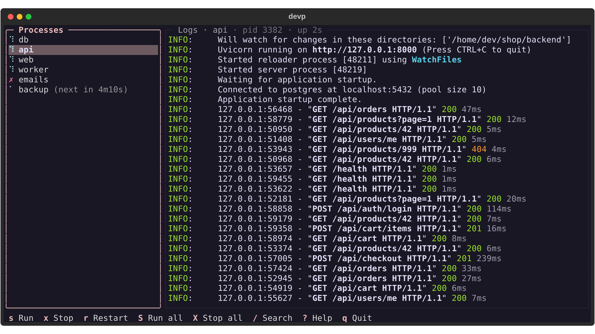

+++
title = 'Stop juggling 5 terminal tabs to run your dev stack'
date = 2026-11-04T20:00:00+01:00
draft = false
tags = ['devp', 'python', 'tooling']
description = 'devp puts your whole dev stack in one terminal window, configured with a single TOML file.'
+++

You know the ritual.

Tab one: `npm run dev`.
Tab two: `uvicorn app:app --reload`.
Tab three: the worker.
Tab four: the database.
Tab five: "wait, which tab was the error in?"

Then something crashes. You click through every tab looking for red text. You find it, fix it, restart it, and then realize the worker needed the database to be up first. So you restart that too.

Every. Single. Morning.

I got tired of it, so I built **devp**.

Like a magician pulling a rabbit out of a hat, devp pulls your whole dev stack out of one command. 🎩🐰

## So what is devp?

devp puts your whole dev stack in **one terminal window**.

You write down your processes once, in a small `devp.toml` file. Then you type `devp`, and everything starts. On the left you get a list of your processes, and on the right, the live logs of whichever one you pick.



No more tab hunting. One screen. One command.

## Setting it up takes about 30 seconds

Run `devp init` and it writes a starter file for you (more on that [below](#start-from-a-template)). Here's what a real one looks like:

```toml
[devp]                       # devp init adds this for you
version = "0.3.0"
config-version = "1.2"

[[process]]
name = "db"
command = "docker run --rm -p 5432:5432 postgres"
ready_port = 5432            # "ready" once the port answers

[[process]]
name = "backend"
command = "uvicorn app:app --reload"
depends_on = ["db"]          # waits until db is actually ready

[[process]]
name = "frontend"
command = "npm run dev"
cwd = "frontend"

[[process]]
name = "worker"
command = "python worker.py"
autorestart = true           # crashes? it comes back
watch = ["src/**/*.py"]      # code changes? it restarts
```

That's it. Save the file, run `devp`, and go get your coffee.

## The stuff you'll actually love

**Start things in the right order.** `depends_on` doesn't just start the database first. It waits until the database is *really* up: the port answers, or a line like "ready to accept connections" shows up in its logs. No more backends crashing because Postgres was still yawning.

**Crashes fix themselves.** Turn on `autorestart` and a crashed process comes back on its own. If it keeps crashing, devp waits a bit longer each time, so a broken script doesn't spin your CPU all day.

**Restart on save.** Give a process a `watch` list, and devp restarts it when those files change. Like nodemon, but for anything.

**Logs that look right.** Colors stay colored. Emoji stay emoji. And progress bars that redraw themselves (`[ 4%] ... [100%]`) show up as one clean line, not fifty glued together.

**Find stuff fast.** Press `/` to search a log, and `n` / `N` to jump between matches. Drag with the mouse to select text, then press `Ctrl+C` to copy it.

**Cron jobs, too.** Need a cleanup script every 15 minutes? Add a `[[cron]]` entry. You'll see a live countdown to its next run.

**Edit the config without restarting.** Save `devp.toml` while devp is running, and it asks whether to reload. Made a typo? It tells you, and keeps running the old config.

**You never have to memorize keys.** The bar at the bottom only shows the keys that work where you are right now. Forgot something? Press `?`.

**It stays smooth under pressure.** Even when a process spits out thousands of log lines a second, the app keeps up with your keypresses.

**Environments done right.** Give a process a `venv` and it runs inside that virtualenv, or set `env = { DEBUG = "1" }` for plain environment variables. No more `source .venv/bin/activate` in every tab.

**Works on Windows too.** Processes are stopped gently, not just killed, and it works in pretty much any terminal. You can even pick the shell: `bash`, `zsh`, `pwsh`, whatever you like.

## Start from a template

`devp init` doesn't just dump a blank file anymore. It shows a small menu right in your terminal, and the template that looks like your project is already highlighted, so usually it's just Enter.

There are templates for `react`, `next`, `vue`, `node`, `fastapi`, `flask`, `django`, `python`, `go`, `rust` and `docker` (Compose), plus `workspace` for monorepos, which gives you one entry per subfolder, each with its own `cwd`.

It also picks up your tooling. JavaScript commands use whichever package manager your project uses (npm, pnpm, yarn or bun), and Python commands use `poetry run`, `uv run` or `pipenv run`, or set `venv` when there's a `.venv` folder.

```bash
devp init                  # pick from the menu
devp init -t fastapi       # skip the menu
devp init --list           # see every template
```

Detection is a good guess, not a promise, so read the file before you run it.

## Let scripts and AI agents drive it

While devp runs, it serves a small local API. Anything on your machine can list, start, stop and restart your processes and read their logs, and it all shows up live in the TUI as if you had pressed the keys yourself.

```bash
devp ctl list                # every process with its state, pid and restarts
devp ctl restart backend     # restart one, add --wait-ready to block until it's up
devp ctl logs worker -n 100  # the last 100 lines, with the colors stripped
devp ctl stop-all            # dependents first
```

Results come back as JSON, so an editor plugin, a shell script or an AI coding agent can check *why* the backend died without scraping your screen.

It's local-only and token-protected, and it can only start processes that are already in your `devp.toml`, so it can't be used to run arbitrary commands. Don't want it at all? Run `devp --no-api`.

## Run it in a browser

```bash
devp --web
```

That runs your processes without a terminal UI and serves the same interface to a browser at `http://localhost:8000`. Handy on a remote box or when someone else wants to watch the logs. It prints a URL with an access token; open that. If you bind it to `0.0.0.0` so other machines can reach it, read the README's warning first.

## "Why not just use tmux?"

Fair question! tmux is great, but you still have to set up the panes, start each command by hand, and remember which pane is which. devp knows *what* your processes are, so it can start them in order, restart them, and tell you when one breaks.

And compared to Docker Compose: devp runs your processes directly on your machine. Your hot reload, your debugger and your local tools keep working exactly as they do now.

## Try it

You'll need Python 3.11 or newer.

```bash
pipx install git+https://github.com/thefr0gg/devp
cd your-project
devp init
devp
```

The keys you'll use most:

| Key | What it does |
|-----|--------------|
| `s` / `x` / `r` | start / stop / restart the selected process |
| `S` / `X` | start / stop everything |
| double-click | run the process you clicked |
| `/` | search the log |
| `G` | jump back to the newest output |
| `?` | show all the keys |
| `q` | quit (and stop everything cleanly) |

## What's next?

devp is young, and I'd love your help shaping it. Try it on your own project and tell me what's missing:

- ⭐ Star it on GitHub: [github.com/thefr0gg/devp](https://github.com/thefr0gg/devp)
- 🐛 Found a bug or have an idea? Open an issue.
- 💬 Or just drop a comment below: what does *your* dev stack look like?

Close those extra tabs. You won't need them anymore. 🙂
